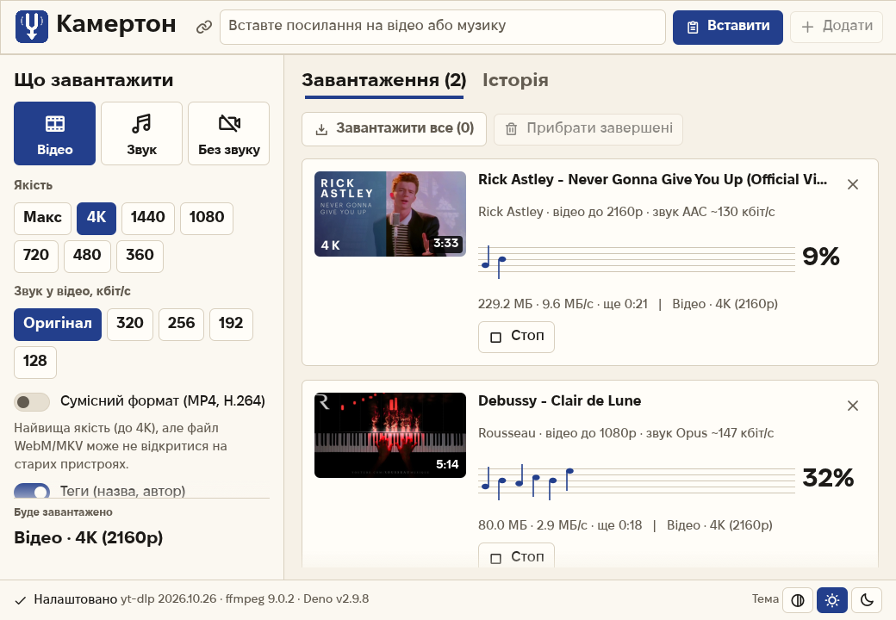
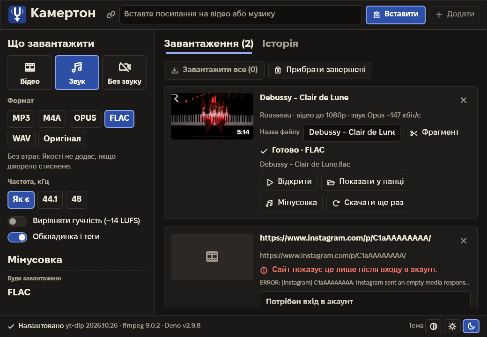
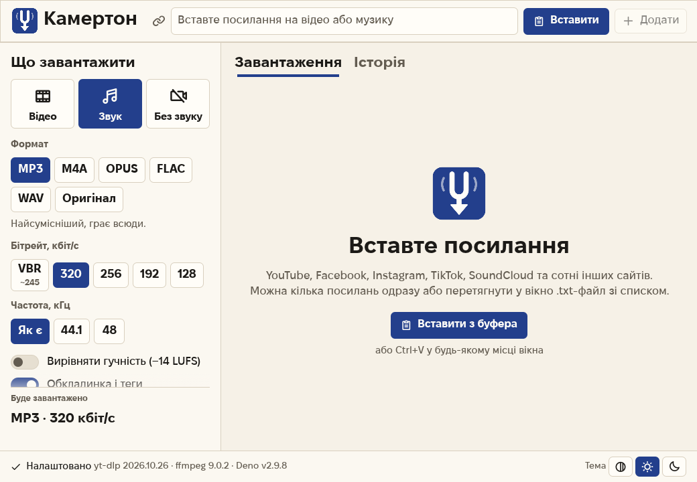

<div align="center">


# Камертон

**Завантаження відео і музики з YouTube, Facebook, Instagram, TikTok, SoundCloud та сотень інших сайтів.**
Один файл. Без Python, без ручного встановлення ffmpeg, з автооновленням.

[](https://github.com/OlexiyOdarchuk/kamerton/releases/latest)
[](LICENSE)

### [⬇ Завантажити для Windows](https://github.com/OlexiyOdarchuk/kamerton/releases/latest/download/kamerton-windows-x86_64.exe)

[Linux](https://github.com/OlexiyOdarchuk/kamerton/releases/latest/download/kamerton-linux-x86_64) · [macOS (Apple Silicon)](https://github.com/OlexiyOdarchuk/kamerton/releases/latest/download/kamerton-macos-aarch64)

</div>



## Що вміє

- **Відео** до 4K, **лише звук** або **відео без звуку**.
- **Звук** у MP3, M4A, Opus, FLAC, WAV або без перекодування. Бітрейт, частота дискретизації, вирівнювання гучності (EBU R128, −14 LUFS). Програма показує, який звук у джерелі, щоб не роздувати файл марним бітрейтом.
- **Сумісний формат** MP4/H.264: файл відкриється на будь-якому телефоні, телевізорі й у редакторі.
- **Фрагмент**: скачати лише шматок з 1:20 до 3:45, з точним розрізом.
- Свої назви файлів, плейлисти, кілька завантажень одночасно, історія з кнопкою «Показати у папці».
- Обкладинка й теги у звукових файлах.
- **Вхід через браузер.** Якщо сайт показує відео лише після входу (приватні відео, групи Facebook, Instagram, вікові обмеження), картка пояснює, що робити, і пропонує взяти вхід з установленого браузера. Пароль програма не бачить.
- Світла й темна тема, або як у системі.
- Посилання на [vocalremover.org](https://vocalremover.org/) для мінусовок.



## Встановлення

**Windows.** Завантажте файл за посиланням вище і запустіть. При першому запуску програма сама встановиться в `%LOCALAPPDATA%\Programs\Kamerton` і створить ярлик «Камертон» на робочому столі та в меню «Пуск». Права адміністратора не потрібні. Завантажений файл після цього можна видалити.

Програма не підписана сертифікатом, тому Windows може показати «Windows захистив ваш комп'ютер». Натисніть **«Докладніше»**, потім **«Виконати все одно»**. Це потрібно лише один раз.

**Linux, macOS.** Завантажте файл, дозвольте запуск (`chmod +x`) і запустіть.

При першому запуску програма докачує потрібні інструменти (близько 100 МБ). Це один раз, далі лише невеликі оновлення.



## Як це працює

Камертон є оболонкою над [yt-dlp](https://github.com/yt-dlp/yt-dlp) з інтерфейсом на [egui](https://github.com/emilk/egui). Інструменти докачуються в теку даних користувача і перевіряються на оновлення при кожному запуску:

| Інструмент | Звідки |
|---|---|
| yt-dlp | [yt-dlp/yt-dlp](https://github.com/yt-dlp/yt-dlp/releases) |
| Deno (потрібен yt-dlp для YouTube) | [denoland/deno](https://github.com/denoland/deno/releases) |
| ffmpeg, Windows | збірка [gyan.dev](https://www.gyan.dev/ffmpeg/builds/), дзеркало [GyanD/codexffmpeg](https://github.com/GyanD/codexffmpeg/releases) |
| ffmpeg, Linux і macOS | [ffmpeg.martin-riedl.de](https://ffmpeg.martin-riedl.de/) |

Сама програма теж оновлюється: при запуску перевіряє останній реліз цього репозиторію, у фоні встановлює новішу версію і пропонує перезапуститись.

## Збірка

```sh
cargo build --release

# Windows з Linux (потрібен mingw-w64):
rustup target add x86_64-pc-windows-gnu
cargo build --release --target x86_64-pc-windows-gnu
```

Тести:

```sh
cargo test                               # швидкі
cargo test -- --ignored --nocapture      # з мережею: ставить інструменти і качає коротке відео
```

## Ліцензія

[MIT](LICENSE).

Сторонні ресурси в `assets/fonts`: шрифт [Fixel](https://github.com/macpaw/fixel) від MacPaw (SIL Open Font License, `Fixel-OFL.txt`) та іконки [Phosphor](https://phosphoricons.com) (MIT, `Phosphor-LICENSE.txt`).
